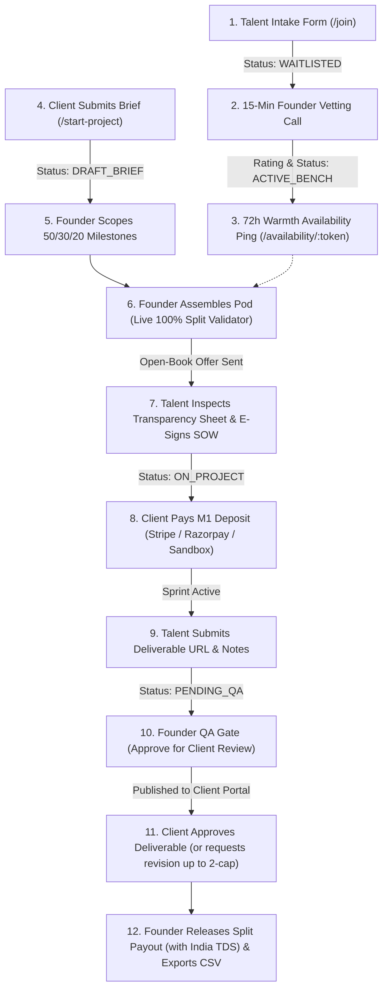

# OpenBench — Transparent Managed Talent Collective

> **A production-ready, full-stack web application for an open-book, founder-managed talent collective operating across the US, UK, Europe, and India.**

[](https://react.dev/)
[](https://www.typescriptlang.org/)
[](https://vitejs.dev/)
[](https://tailwindcss.com/)
[](https://expressjs.com/)
[](https://www.prisma.io/)
[](#zero-floating-point-money-math)

---

## 🌟 Core Business Model

1. **Two-Sided Vetted Bench (Not a Passive Waitlist)**:
   - Freelancers move through a strict pipeline: `WAITLISTED` → `VETTING` (15-min founder call) → `ACTIVE_BENCH` → `ON_PROJECT`.
   - A built-in tokenized availability ping system (`/availability/:token`) keeps the bench warm so founders always know who can start within **72 hours**.
2. **Initial Launch Verticals**:
   - **Web & App Development** (React 19, TypeScript, Node.js, PostgreSQL, React Native)
   - **UI/UX Product Design** (Figma, Design Systems, UX Research, Interactive Prototypes)
   - **Video & Motion Editing** (Premiere Pro, After Effects, DaVinci Resolve)
   - **Digital Growth Marketing** (B2B SEO, Paid Acquisition, Lifecycle CRO)
3. **Founder-Managed Delivery (2-Person Ops Team)**:
   - Two founders personally supervise client acquisition, scoping, pod selection, deliverable QA review, and milestone sign-offs through a dedicated **Admin Ops Console**.
4. **Open-Book Project Budget Sharing**:
   - Fixed project budgets in **USD ($), GBP (£), EUR (€), or INR (₹)** via milestone deposits.
   - **70/30 Split Rule**: 70% paid directly to the Execution Pod specialists; 30% transparent platform margin (12% sales & ops, 10% founder PM & QA, 8% backup reserve/margin).
   - Specialists review the full client gross contract, platform margin breakdown, and their exact fixed payout before e-signing the Scope of Work.
5. **50% / 30% / 20% Milestone Release Schedule**:
   - **Milestone 1 (50% upfront deposit)**: Architecture blueprint, design specs & kickoff sprint.
   - **Milestone 2 (30% mid-delivery)**: Core implementation & founder QA review.
   - **Milestone 3 (20% final sign-off)**: Handover, production deploy & IP transfer.
   - **Strict 2-Round Revision Cap**: Prevents endless scope creep; additional client requests automatically freeze and prompt a funded Change Order.
6. **India Tax Compliance (TDS)**:
   - Automated deduction preview for Indian contractors under **Section 194J (10% Technical/Professional)** or **Section 194C (1% Contractual)**, recording PAN and GSTIN on downloadable payout receipts.

---

## 🏗️ Architecture & Monorepo Structure

```
startup/
├── docker-compose.yml          # Multi-container orchestration (PostgreSQL 16, API Server, Nginx SPA)
├── package.json                # Root npm workspaces configuration
├── README.md                   # System documentation & quickstart
│
├── server/                     # Express + TypeScript Modular REST API
│   ├── prisma/
│   │   ├── schema.prisma       # Relational schema (SQLite zero-config local dev)
│   │   ├── schema.postgresql.prisma # Relational schema (PostgreSQL production)
│   │   └── seed.ts             # Realistic database seeder
│   └── src/
│       ├── config/env.ts       # Zod-validated environment config
│       ├── services/
│       │   ├── mathEngine.ts   # Zero floating-point money math engine (Largest Remainder)
│       │   ├── paymentService.ts # Unified Stripe (USD/GBP/EUR) + Razorpay (INR) + Sandbox
│       │   ├── emailService.ts # Transactional emails & dev preview logger
│       │   ├── storageService.ts # Deliverable & SOW upload storage
│       │   └── prisma.ts       # Prisma Client singleton
│       ├── middleware/
│       │   ├── auth.ts         # JWT + HttpOnly refresh cookie + RBAC guards
│       │   ├── validate.ts     # Zod request validators
│       │   └── rateLimiter.ts  # Express rate limiting
│       ├── controllers/
│       │   ├── authController.ts
│       │   ├── talentController.ts
│       │   ├── clientController.ts
│       │   ├── adminController.ts
│       │   └── publicController.ts
│       └── tests/
│           ├── mathEngine.test.ts # Unit tests for budget-split math & TDS
│           └── e2eLifecycle.test.ts # 11-step complete happy path lifecycle test
│
└── client/                     # React 19 + TypeScript + Vite + Tailwind CSS SPA
    ├── index.html
    ├── vite.config.ts
    ├── tailwind.config.js
    └── src/
        ├── types/index.ts      # TypeScript interfaces matching backend models
        ├── lib/
        │   ├── api.ts          # Authenticated fetch wrapper
        │   └── formatters.ts   # Zero-layout-shift currency & date formatters
        ├── context/
        │   └── AuthContext.tsx # Authentication state & 1-click demo switcher
        ├── components/
        │   ├── layout/         # Navbar, Footer, PortalLayout (Sidebar + Founder Card)
        │   └── shared/         # BudgetCalculator, StatusBadge
        └── pages/
            ├── public/         # LandingPage, JoinWaitlistPage, StartProjectPage, AvailabilityConfirmPage, LoginPage
            ├── talent/         # TalentDashboard, TalentInvitationDetail, TalentProjectWorkspace, TalentPayouts, TalentProfile
            ├── client/         # ClientDashboard, ClientProjectWorkspace, ClientNewProject
            └── admin/          # AdminDashboard, AdminTalentCRM, AdminProjectsList, AdminProjectScoping, AdminPodAssembler, AdminQAGateAndPayoutLedger
```

---

## ⚡ Zero Floating-Point Money Math

All monetary values are stored and calculated strictly in **integer minor units** (cents / paise) with deterministic remainder distribution (**Largest Remainder Method / Hare-Niemeyer**).

$$\sum (\text{Specialist Payouts}) + \text{Platform Fee} \equiv \text{Gross Budget Minor Units}$$

No fractional cents are ever lost or created out of thin air. Even uneven splits (e.g. \$10,000.01 divided among 3 contractors) resolve with exact cent parity.

---

## 🚀 Quickstart & Local Setup

### Prerequisites
- **Node.js**: v18+ (tested on v24.15 LTS)
- **npm**: v9+ (tested on v12.0)

### 1. Install Dependencies
From the repository root:
```bash
npm install
```

### 2. Database Sync & Realistic Seed
Generates the Prisma client and populates 2 Admins, 6 realistic Talent members, 2 Clients, and 2 live sample projects:
```bash
npm --prefix server run prisma:generate
npm --prefix server run prisma:push
npm run seed
```

### 3. Run Math & E2E Test Suite
Executes the unit tests and the 11-step end-to-end lifecycle verification test:
```bash
npm test
```
*Expected result: 7 tests passed across 2 test suites.*

### 4. Start Local Development Servers
Run both backend API (`localhost:5000`) and frontend SPA (`localhost:5173`):
```bash
# Terminal 1: Backend API Server
npm run dev:server

# Terminal 2: Frontend Vite SPA
npm run dev:client
```
Visit **http://localhost:5173** in your browser.

---

## 🔑 Pre-Seeded Demo Accounts (One-Click Testing)

All accounts share the default password: **`Password123!`**.
You can sign in manually or use the built-in **"Demo Switcher"** button in the navigation bar for instant 1-click role swapping.

| Role | Account / Persona | Email | Purpose & View |
|---|---|---|---|
| **ADMIN** | Alex Morgan (Founder 1) | `alex@openbench.io` | Ops Console, Talent Bench CRM, 50/30/20 Scoping Builder, Pod Assembler, QA Gate & Payout Release |
| **ADMIN** | Priya Sharma (Founder 2) | `priya@openbench.io` | Founder Lead for India / APAC clients, 194J/C TDS compliance review |
| **TALENT** (US) | Marcus Vance | `marcus.vance@gmail.com` | Lead Full-Stack Architect (`ACTIVE_BENCH` / `ON_PROJECT` on Billing Portal, $6,750 fixed payout) |
| **TALENT** (UK) | Elena Rostova | `elena.rostova@designpod.co.uk` | Senior UI/UX Designer (`ON_PROJECT` on Billing Portal, $3,750 fixed payout) |
| **TALENT** (Germany) | Lukas Becker | `lukas.becker@berlincode.de` | Full-Stack Docker & React Engineer (`ACTIVE_BENCH`, Available Now) |
| **TALENT** (India) | Arjun Mehta | `arjun.mehta@devstack.in` | Mobile & Full-Stack Specialist (`ON_PROJECT`, Section 194J 10% TDS) |
| **TALENT** (India) | Rohan Nair | `rohan.nair@motionstudios.in` | Video & Motion Editor (`VETTING` stage, 15-min call queued) |
| **TALENT** (UK) | Sophie Taylor | `sophie.taylor@growthlab.co.uk` | Digital Growth Marketer (`WAITLISTED`, portfolio submitted) |
| **CLIENT** (US) | Sarah Connor (ApexScale Inc.) | `sarah.connor@apexscale.com` | Active Client ($15,000 Billing Portal project with M1 deposit paid & QA pending) |
| **CLIENT** (India) | Vikram Singh (ZenithFlow Ltd) | `vikram.singh@zenithflow.in` | Client with `DRAFT_BRIEF` ready for founder scoping (₹8,00,000 target budget) |

---

## 🔄 The 11-Step Verified Happy Path



1. **Talent Applies**: Candidate registers on `/join` with portfolio links, rates, and weekly capacity. Status starts as `WAITLISTED`.
2. **Founder Vets**: Founders review the portfolio in `/admin/talent`, conduct a 15-min call, log notes, and promote to `ACTIVE_BENCH`.
3. **Availability Ping**: Clicking "Ping" dispatches a passwordless link (`/availability/:token`) where talent updates capacity ("Available Now (Next 72h)").
4. **Client Brief**: Client submits project scope and target budget on `/start-project`.
5. **Fixed Scoping**: Admin converts brief into a fixed-scope project on `/admin/projects/:id/scope`, locking the 50/30/20 milestones and 2-round revision cap.
6. **Pod Assembly**: Admin selects 1–4 specialists on `/admin/projects/:id/pod`. The live validator ensures Platform % + Talent % === 100%.
7. **E-Sign SOW**: Talent receives the Open-Book transparency sheet on `/talent/invitations/:id` showing gross client budget, platform margin %, and exact fixed payout, then e-signs with legal name and IP recording.
8. **Deposit Paid**: Client pays Milestone 1 deposit via Stripe (USD/GBP/EUR), Razorpay (INR), or unified test sandbox mode.
9. **Deliverable Submitted**: Talent works the sprint and submits release URLs on `/talent/projects/:id`.
10. **Founder QA Gate**: Founders test the deliverable on `/admin/projects/:id/qa` and click "Approve for Client".
11. **Client Approval & Payout Release**: Client signs off. Founder marks contractor payouts as `RELEASED` with transaction reference ID and exports the CSV bookkeeping ledger.

---

## 🔒 Security & Production Hardening

- **Zero Floating-Point Money Math**: Deterministic Largest Remainder distribution; integer cents/paise throughout.
- **Strict Authorization Middleware**: Role-based access control (RBAC) enforced on every endpoint. Talent can only view their own projects/invitations; clients can only view their own deliverables.
- **Payment Webhook Idempotency**: Stripe & Razorpay event verification with `ProcessedWebhookEvent` tracking to prevent duplicate deposit crediting.
- **Revision Cap Guard**: Hard limit of 2 revision rounds per milestone; subsequent revision requests are blocked and require a funded Change Order.
- **Audit Logging**: All critical events (SOW e-signing, milestone deposits, QA reviews, and payout disbursements) write tamper-evident JSON audit entries.
- **DevOps**: Production Docker Compose configuration with PostgreSQL 16 container, rate limiting, Helmet HTTP security headers, CORS origin verification, and Pino structured logging.

---

## 📜 License

MIT License. Designed and engineered for **OpenBench Collective Inc.**
