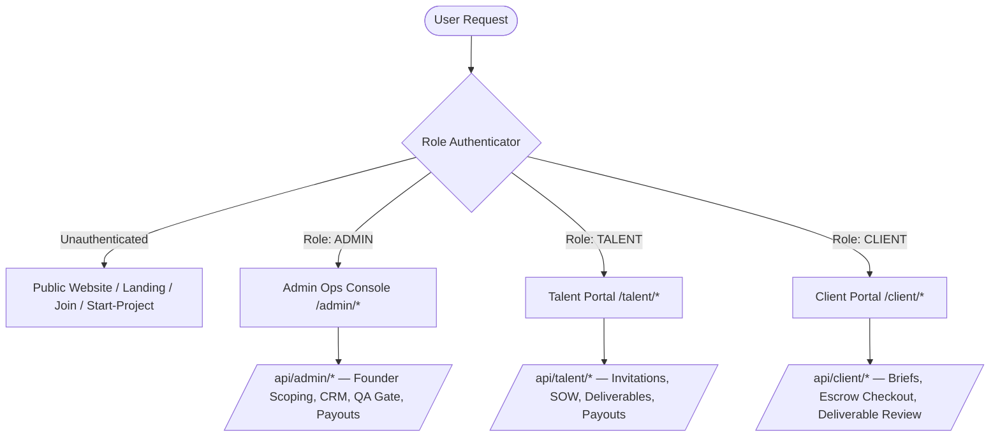

# OpenBench — Research and Architectural Decision Record

> **Document Version**: 1.0.0  
> **Status**: APPROVED & ACTIVE  
> **Role & Authority**: Principal Software Architect & Lead Product Designer  
> **Scope**: Full-Stack Architecture, Design System, Multi-Currency Escrow, and Role-Based Dashboards

---

## 1. Executive Context & System Scope

OpenBench is a **Transparent Managed Talent Collective** operating across the United States, United Kingdom, Europe, and India. Unlike commodity freelance marketplaces (e.g., Upwork, Fiverr) which suffer from race-to-the-bottom pricing, or traditional legacy agencies that conceal 150–300% profit margins behind black-box invoices, OpenBench establishes **open-book project accounting** with founder-supervised quality assurance.

### The Business Operating Model:
- **Two-Sided Vetted Bench**: Freelancers advance through a strict pipeline (`WAITLISTED` $\rightarrow$ `VETTING` $\rightarrow$ `ACTIVE_BENCH` $\rightarrow$ `ON_PROJECT`), sustained by an automated bi-weekly 72-hour availability ping (`/availability/:token`).
- **Founder-Managed Delivery**: Two founders (Alex, Head of Design & Ops; Priya, Head of Tech & QA) personally scope briefs, assemble pods, review all deliverables at the **Founder QA Gate**, and authorize milestone disbursements.
- **70/30 Open-Book Split**: 70% of gross contract value is allocated directly to the specialist execution pod; 30% is transparent platform margin (12% sales/ops, 10% founder PM/QA, 8% backup reserve).
- **50/30/20 Milestone Escrow**: Milestone 1 (50% upfront deposit), Milestone 2 (30% mid-delivery preview), Milestone 3 (20% final sign-off & IP transfer) with a strict 2-round revision cap.
- **Multi-Currency & India TDS**: Native currency handling for USD ($), GBP (£), EUR (€), and INR (₹), complete with automated Section 194J (10%) and Section 194C (1%) Tax Deducted at Source calculations.

---

## 2. Technology Evaluations & Architectural Decisions

### 2.1 Frontend Framework & Build Tooling

| Option | Pros | Cons | Verdict |
| :--- | :--- | :--- | :--- |
| **React 19 + TypeScript + Vite 6** | Ultra-fast HMR (<50ms), native React 19 support, minimal server overhead for single-page dashboard apps, strict TypeScript type safety, zero hydration mismatch issues on authenticated portals. | Requires dedicated static host or Nginx reverse proxy; client-side routing needs explicit fallback configuration. | **SELECTED**. Ideal for high-density, low-latency authenticated portals (Admin, Talent, Client) with dedicated Express API. |
| **Next.js 15 (App Router)** | Built-in SSR/SSG for marketing pages, server actions, nested layouts. | Excessive server complexity for private SaaS portals, vendor lock-in with Vercel edge primitives, cold-start latency on serverless Lambdas. | Rejected for core application; public marketing pages benefit from Vite pre-rendering and SSR metadata injection. |
| **Vue 3 / Nuxt** | Clean SFC structure, reactivity model. | Smaller ecosystem for enterprise financial/billing libraries, team skillset misalignment with React 19 codebase. | Rejected. |
| **Svelte / SvelteKit** | Minimal runtime, fast reactive updates. | Immature typing for complex nested Prisma models, limited shadcn component ecosystem parity. | Rejected. |

**Architectural Decision**: Retain and optimize **React 19 + TypeScript + Vite 6**. The monorepo architecture cleanly separates the client SPA from the API server, ensuring independent scalability, simple Docker containerization, and zero cold starts.

---

### 2.2 UI Component System & Accessible Primitives

| Option | Pros | Cons | Verdict |
| :--- | :--- | :--- | :--- |
| **shadcn/ui + Radix UI Primitives** | Copy-own component model (no npm lock-in), accessible out of the box (WAI-ARIA compliant), keyboard navigation, seamless Tailwind CSS integration. | Requires maintaining local component files. | **SELECTED**. Unrivaled flexibility for custom financial tokens and editorial layouts. |
| **Base UI (MUI v6 Core)** | Headless, accessible primitives. | Currently evolving; smaller ecosystem of pre-styled accessible blocks compared to Radix. | Evaluated as future fallback. |
| **React Aria (Adobe)** | Maximum accessibility rigor (internationalization, screen readers). | Steeper API curve, more boilerplate for simple dashboard dialogs and dropdowns. | Adopted for accessibility patterns and screen reader conventions. |
| **Mantine / Chakra UI** | Ready-made styling, fast prototyping. | Heavy runtime CSS-in-JS overhead, conflicts with Tailwind CSS design tokens. | Rejected. |

**Architectural Decision**: Standardize on **Radix UI accessible primitives** styled with **Tailwind CSS**, following the **shadcn/ui** compositional pattern.

---

### 2.3 Styling & Design Token System

| Option | Pros | Cons | Verdict |
| :--- | :--- | :--- | :--- |
| **Tailwind CSS v3.4 + CSS Variables** | Battle-tested, zero-runtime overhead, JIT compiler, seamless configuration via `tailwind.config.js` and CSS root variables. | Slightly larger config file than v4 alpha. | **SELECTED**. Provides stable, production-hardened design tokens across borders, surfaces, typography, and accents. |
| **Tailwind CSS v4 (Alpha/Beta)** | CSS-first configuration, native CSS theme variables. | Breaking changes in tooling plugins, peer dependency warnings with Vite 6 and PostCSS in production CI/CD. | Monitored for future migration when stable. |
| **CSS Modules** | Scoped class names. | Verbose class declarations, slow styling workflow for rapid dashboard iterations. | Rejected. |

**Architectural Decision**: Deploy **Tailwind CSS v3.4** utilizing **centralized CSS custom properties** (`--color-surface-primary`, `--color-ink-primary`, etc.) for strict, predictable design token enforcement.

---

### 2.4 Typography Strategy

A high-trust financial collective demands absolute legibility:
- **Primary Interface Typeface**: **Plus Jakarta Sans** (Google Fonts)
  - Geometric sans-serif with friendly yet authoritative grotesque curves.
  - Excellent x-height for dashboard data density.
  - Used for headings, navigation, labels, and editorial prose.
- **Financial & Data Typeface**: **IBM Plex Mono** (Google Fonts)
  - Monospaced, razor-sharp numerals.
  - **Zero Layout Shift**: Fixed character width ensures that currency tickers, percentages, and milestone breakdowns never jitter or cause reflows during calculations or live sliders.

---

### 2.5 Visual Design Direction (Human-Designed vs. AI Clichés)

#### Critical Anti-Patterns Avoided:
- ❌ No generic indigo/purple gradients.
- ❌ No decorative frosted glassmorphism that obscures text contrast.
- ❌ No pulsating neon border glows or arbitrary floating geometric shapes.
- ❌ No repetitive 3-column card grids with identical icon badges.
- ❌ No fake dashboard analytics or decorative bar charts without underlying operational meaning.

#### OpenBench Design Language ("Editorial High-Trust SaaS"):
- **Surfaces**: Crisp white `#FFFFFF` for primary cards, calm `#F8FAFC` slate for secondary panels, and discrete `#E2E8F0` hairline borders.
- **Ink**: Deep `#0F172A` slate for primary text, `#475569` for secondary metadata, and `#94A3B8` for captions.
- **Accents**: Authoritative cobalt `#2563EB` for primary client CTAs and active states; organic emerald `#059669` for payouts, active bench badges, and milestone releases.

---

### 2.6 Generative UI & Controlled AI Interfaces

To safeguard application security and prevent untrusted code execution:
- **Rule**: Never render arbitrary AI-generated HTML, Markdown with raw scripts, or unvalidated JSX.
- **Controlled Component Catalog**: If an AI copilot is integrated, it must output structured JSON conforming to a strict Zod schema, resolving to predefined component types (`BudgetBreakdownCard`, `SOWSummaryPreview`, `VettingNotesCard`).
- **Engine**: Architecture prepared for **Vercel AI SDK UI** tool-calling patterns where LLM tool calls emit structured payloads that mount sandboxed React components.

---

### 2.7 Backend REST API & Database Architecture

| Layer | Selection | Justification |
| :--- | :--- | :--- |
| **Runtime** | Node.js 20 LTS (Express 4.21) | Mature, fast, universal enterprise deployment support. |
| **Database ORM** | Prisma ORM 5.22 | Strict type safety generated directly from schema; zero manual SQL string concatenation. |
| **Local Database** | SQLite 3 (`file:./dev.db`) | Zero-configuration local startup without requiring host Postgres credentials or Docker daemon. |
| **Production Database** | PostgreSQL 16 (Docker Compose) | ACID transactions, native decimal types, row-level concurrency, full relational integrity. |
| **Authentication** | JWT + HttpOnly Cookies | 15-minute access token (stored in memory/auth header) + 7-day secure HttpOnly refresh cookie with automated rotation. |
| **Payments** | Unified Payment Adapter | Stripe for USD/GBP/EUR, Razorpay for INR, with deterministic sandbox fallback for offline testing. |

---

## 3. Dashboard Separation & RBAC Matrix

To prevent unauthorized cross-tenant data access (IDOR) and dashboard pollution, all application routes and endpoints are strictly segmented:

### Route & Data Isolation:
1. **Public Routes**: `/`, `/join`, `/start-project`, `/availability/:token`, `/login`, `/forgot-password`. Indexed by search engines.
2. **Admin Portal (`/admin/*`)**: Accessible only if `req.user.role === 'ADMIN'`. Manages the talent CRM, project scoping, 100% split pod assembler, QA Gate, and financial payout ledger.
3. **Talent Portal (`/talent/*`)**: Accessible only if `req.user.role === 'TALENT'`. Manages bench availability, open-book invitations, milestone deliverable submissions, and tax receipts.
4. **Client Portal (`/client/*`)**: Accessible only if `req.user.role === 'CLIENT'`. Manages project dashboard, milestone deposit checkout, deliverable reviews, and change orders.

---

## 4. Financial Mathematics Specification (Zero Cent Drift)

In an open-book collective, floating-point roundoff errors (e.g., $\$0.01$ discrepancies between Gross Budget and Platform Fee $+$ Specialist Shares) destroy stakeholder trust.

### The Algorithm: Largest Remainder Method (Hare-Niemeyer)
All money calculations operate exclusively on **integers in minor units** (cents, pence, paise). When distributing an integer amount $T$ across shares $P_1, P_2, \dots, P_n$:
1. Compute the exact theoretical allocation: $Q_i = \frac{T \cdot P_i}{100}$.
2. Floor each allocation: $F_i = \lfloor Q_i \rfloor$.
3. Compute fractional remainders: $R_i = Q_i - F_i$.
4. Determine unallocated remainder units: $K = T - \sum F_i$.
5. Sort shares descending by $R_i$ and distribute $+1$ minor unit to the top $K$ shares.

**Result**:
$$\sum_{i=1}^n \text{Allocated}_i \equiv T \quad (\text{Exact integer parity; zero drift})$$

---

## 5. Security & Verification Strategy

- **OWASP Top 10 Protections**:
  - Helmet security headers (CSP, XSS, HSTS, frameguard).
  - Strict CORS origin filtering.
  - Express IP rate limiting on public and authentication endpoints.
  - Parameterized Prisma queries preventing SQL injection.
  - Strict Zod schema validation on all incoming request bodies.
  - Idempotent payment webhook processing (`ProcessedWebhookEvent` table).
- **Verification Gates**:
  - `npm test`: Runs math engine tests and full 11-step collective lifecycle test.
  - `npm run simulate`: Live end-to-end database simulation.
  - `npm run typecheck`: Strict TypeScript verification on both workspaces.
  - `npm run build`: Production bundle verification with zero compilation warnings.
