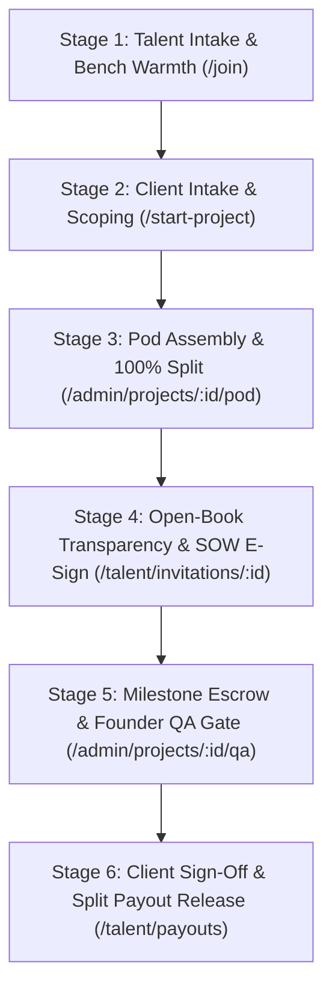

# OpenBench — Master Operational Workflow Manual (Part 1)

> **Standard Operating Procedures (SOP) for the 2-Person Founder Operations Team (Alex & Priya)**  
> *Operating across the United States, United Kingdom, Europe, and India.*

---

## Executive Summary

OpenBench is a **Transparent Managed Talent Collective**, not an open marketplace (like Upwork) and not a black-box agency with 100–300% markups. The business operates on four non-negotiable principles:

1. **Two-Sided Vetted Bench**: Every freelancer is vetted by a founder and kept warm with an automated 72-hour availability ping.
2. **Founder-Managed Delivery**: Founders handle client scoping, pod assembly, deliverable QA, and milestone approvals.
3. **Open-Book Financial Transparency**: 70% of gross budget goes directly to the specialist execution pod; 30% is transparent platform margin (12% sales/ops, 10% founder PM/QA, 8% backup reserve).
4. **Guaranteed Milestone Escrow**: Milestone 1 (50% deposit), Milestone 2 (30% mid-delivery), Milestone 3 (20% final sign-off) with a strict 2-round revision cap.

---

## The 6-Stage Collective Lifecycle

---

### Stage 1: Talent Intake & Bench Warmth

#### 1.1 Specialist Intake Form (`/join`)
Candidates submit:
- **Full Legal Name & Email**
- **Country & Timezone** (US, UK, Europe, India)
- **Primary Category** (Web & App Dev, UI/UX Design, Video Editing, Digital Marketing)
- **Verified Portfolio Links** (GitHub, Figma, Dribbble, Live URLs)
- **Years of Experience & Weekly Hours Available** (e.g., 20–40 hrs/wk)
- **Minimum Project Size & Preferred Currency** (USD, GBP, EUR, INR)
- **Master Contractor Agreement Consent**

*Resulting Database State:* `User.role = "TALENT"`, `TalentProfile.status = "WAITLISTED"`.

#### 1.2 Founder 15-Minute Vetting Protocol (`/admin/talent`)
Alex (Design/Ops) and Priya (Tech/QA) conduct a focused 15-minute screen:
- **00–05 min**: Portfolio walkthrough & real production code/design review.
- **05–10 min**: Availability reliability & communication standards.
- **10–15 min**: Open-book model alignment (explaining the 70/30 split and 50/30/20 escrow).

**Founder Actions in Admin CRM**:
1. Enter detailed vetting notes in the modal.
2. Assign an internal delivery rating ($1.0$ to $5.0$).
3. Click **"Promote to Active Bench"** (`TalentProfile.status = "ACTIVE_BENCH"`).

#### 1.3 72-Hour Availability Ping System (`/availability/:token`)
Every alternate Monday, an automated ping is dispatched to active bench members. Specialists click their passwordless token link and select one of three states:
- 🟢 **Available Now (Next 72 Hours)**: Top priority for new project pods.
- 🟡 **Available in 2 Weeks**: Queued for upcoming pipeline briefs.
- 🔴 **Currently Booked**: Temporarily hidden from pod assembler.

---

### Stage 2: Client Intake & Scoping

#### 2.1 Project Brief Submission (`/start-project`)
Clients submit:
- Company name, contact person, billing country, and currency.
- Project title, category, high-level scope, target timeline, and target budget.
- Creates `Project.status = "DRAFT_BRIEF"`.

#### 2.2 Founder Scoping Builder (`/admin/projects/:id/scoping`)
Founders turn ambiguous briefs into contractual certainty:
1. **Gross Project Budget**: Fixed contract price in minor units ($10,000$ = `1000000` cents).
2. **Platform Share %**: Default $30.0\%$ (editable).
3. **Milestone Schedule**: Default $50\% / 30\% / 20\%$. Live validator enforces that milestone percentages strictly equal $100\%$.
4. **Strict Revision Cap**: Default $2$ rounds per milestone.

---

### Stage 3: Pod Assembly & 100% Split Validation

#### 3.1 Pod Assembler (`/admin/projects/:id/pod`)
Founders select 1 to 4 active specialists matching required skills and assign role titles and budget percentages.

**The Golden Split Formula**:
$$\text{Platform Margin } (30\%) + \sum_{i=1}^{N} \text{Specialist Share}_i = 100\%$$

*Example for $10,000 USD Project:*
- Platform Margin ($30\%$): $\$3,000$
  - $12\%$ Sales & Client Ops: $\$1,200$
  - $10\%$ Founder PM & QA: $\$1,000$
  - $8\%$ Backup Reserve & Float: $\$800$
- Lead Full-Stack Architect ($40\%$): $\$4,000$
- Lead UI/UX Product Designer ($30\%$): $\$3,000$
- **Total Allocated**: $\$10,000.00$ ($0$ cent drift).

---

### Stage 4: Open-Book Transparency & SOW E-Sign

#### 4.1 Specialist Offer Review (`/talent/invitations/:id`)
Specialists receive an invitation displaying full open-book transparency:
- Gross client budget
- Itemized platform margin breakdown
- Other pod member roles and percentages
- Their exact milestone payout amounts
- 2-round revision cap and IP assignment clause

#### 4.2 Legal E-Signature
The specialist types their legal name and clicks **"Accept & E-Sign SOW"**. The system cryptographically records:
- `signedName`
- `signedAt` (ISO timestamp)
- Client IP address and User-Agent
Project transitions to `AWAITING_DEPOSIT`.

---

### Stage 5: Milestone Escrow & Founder QA Gate

#### 5.1 Client Milestone Deposit (`/client/projects/:id`)
Before any work begins, the client deposits Milestone 1 ($50\%$) via Stripe or Razorpay. Project status becomes `IN_PROGRESS`.

#### 5.2 Deliverable Upload (`/talent/projects/:id`)
Specialists build deliverables and submit live preview URLs, Figma links, or GitHub commits. Deliverables are submitted to the **Founder QA Gate**, not directly to the client.

#### 5.3 Founder QA Gate Review (`/admin/projects/:id/qa`)
Founders personally review all work against acceptance criteria:
- **Passes QA**: Click **"Approve for Client Review"** $\rightarrow$ published to Client Portal.
- **Needs Adjustments**: Click **"Return to Talent"** with concrete feedback.

---

### Stage 6: Client Sign-Off & Split Payout Release

#### 6.1 Client Deliverable Review & Revision Cap
Clients inspect deliverables on `/client/projects/:id`:
- **Approve Milestone**: Releases escrow to contractor payout pool.
- **Request Revision**: Allowed up to 2 rounds. On round 3, the platform automatically freezes revisions and prompts a paid **Change Order Request**.

#### 6.2 Split Payout Release with India TDS (`/admin/projects/:id/qa`)
Founders disburse contractor payouts via bank transfer, Wise, or UPI:
- **Section 194J (India)**: $10\%$ TDS deducted on professional/technical fees.
- **Section 194C (India)**: $1\%$ TDS deducted on contractual works.
- Founder inputs transaction reference (`TXN_OB_...`) and clicks **"Release Payout"**.

#### 6.3 Contractor Invoice / Receipt View (`/talent/payouts`)
Contractors view and print official tax-compliant payout receipts showing:
- OpenBench Collective Header
- Milestone description & currency
- Gross earned amount
- India TDS deducted (with PAN and GSTIN)
- Net disbursed amount & transaction reference ID
